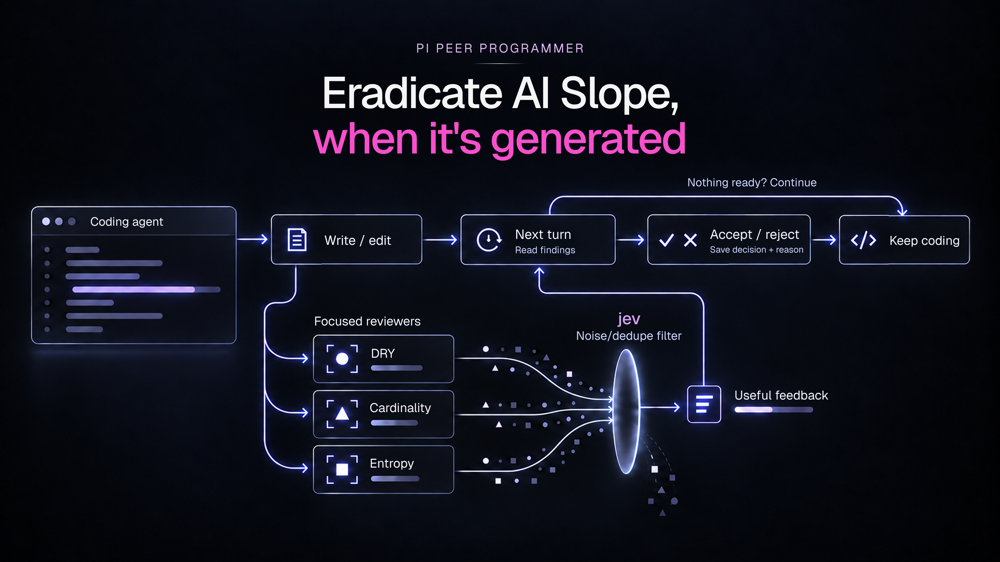
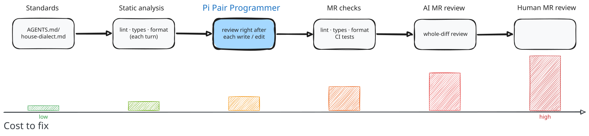
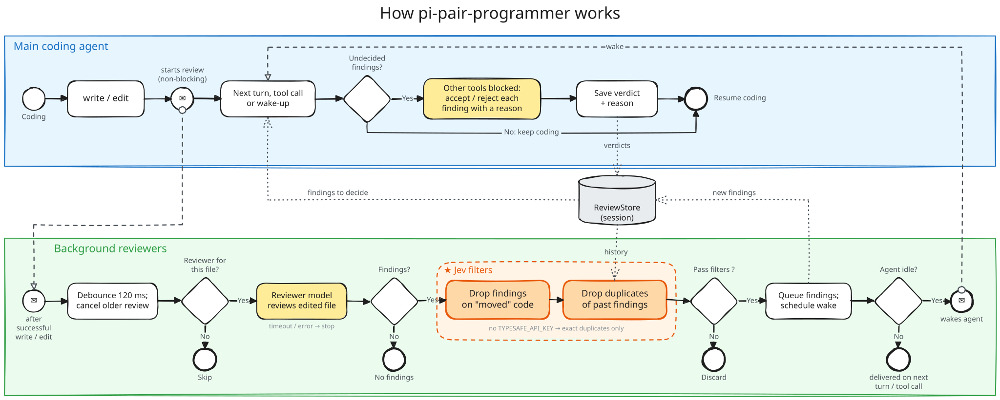

<a id="top"></a>

<div align="center">

# 🧑‍💻 Pi Pair Programmer

**Background code review for [Pi](https://pi.dev/docs/extensions) and [OMP](https://omp.sh/docs/extension-authoring).**

[](https://github.com/T-moz/pi-pair-programmer/actions/workflows/ci.yml)
[](vitest.config.ts)
[](https://www.npmjs.com/package/pi-pair-programmer)
[](https://www.npmjs.com/package/pi-pair-programmer)
[](package.json)
[](tsconfig.json)
[](LICENSE)

[**Why**](#-why) · [**Install**](#-install) · [**Use**](#-use) · [**How it works**](#-how-it-works)

<br />



</div>

---

## 🤔 Why

> **Coding with AI adds entropy to a codebase.**
> Agents optimize for local correctness instead of thinking about the global system. They repeat code and reinvent the wheel.

Turn-by-turn static analysis is necessary but not sufficient.
Code review happens too late in the code production pipeline.

<p align="center">
  
</p>

This extension lets you run multiple highly specialized reviewers, each focused on a specific concern, to catch issues static analysis cannot detect, as soon as code is generated. Without bloating the context window, thanks to a Jev-based filter that removes inherited and duplicate findings.

---

## 📦 Install

Install the published [npm package](https://www.npmjs.com/package/pi-pair-programmer).

<table>
<tr>
<th>With Pi</th>
<th>With OMP</th>
</tr>
<tr>
<td>

```sh
pi install npm:pi-pair-programmer
```

</td>
<td>

```sh
omp install pi-pair-programmer
```

</td>
</tr>
</table>

Restart Pi or OMP after installation to load the extension.

🔑 For the Jev filter, set your TypeSafe API key before starting Pi or OMP:

```sh
export TYPESAFE_API_KEY="your-api-key"
```

> [!NOTE]
> Without it, reviews still run, but only exact duplicate findings are filtered.

---

## 🧭 Use

Reviews are on by default. After each successful `write` or `edit`, reviewers run in the background. At the end of each turn, files changed another way, such as `sed -i` in `bash`, are reviewed too (in git repositories, up to 20 files per turn). The coding agent must accept or reject each finding with a reason before continuing with other tools. Only accepted findings appear in your transcript.

Pi subagents started with [pi-subagents](https://github.com/nicobailon/pi-subagents) load the extension too, whatever their working directory. Sessions without a UI, such as subagents and `pi -p`, wait for running reviews before they finish, so findings are always decided.

> [!IMPORTANT]
> A session whose tool allowlist leaves out `pair_programmer_decide` turns reviews off with a warning. Built-in pi-subagents agents such as `worker` have an allowlist, so add the tool through `subagents.agentOverrides.<agent>.tools`. Otherwise the parent session reviews the subagent's changes at the end of its turn.

| Command            | Action                                                                                              |
| ------------------ | --------------------------------------------------------------------------------------------------- |
| `/pair-programmer` | Toggle reviews.                                                                                     |
| `/pair-clear`      | Cancel reviews and clear all findings.                                                              |
| `/pair-stats`      | View review activity, findings, tokens, and estimated costs on demand; missing usage stays unknown. |

In RPC clients such as [T3 Code](https://github.com/pingdotgg/t3code), which hide extension messages, Pi Pair Programmer reports through notifications and status instead: accepted findings appear as notifications, the status shows running reviews and findings left to decide, decision results name the finding and its location, and `/pair-stats` prints as a notification.

The default reviewer uses your current model and asks: _“Does it add entropy?”_ Pi warns when it applies. To change the prompt, model, or files reviewed, create `pair-programmer.reviewers.json` in your working directory or any folder above it, up to the git root:

```json
{
  "reviewers": [
    {
      "model": "current",
      "prompt": "Does this code add entropy?",
      "include": ["**/*.dart"],
      "exclude": ["**/*.g.dart", "**/*_test.dart"]
    },
    {
      "model": "current",
      "prompt": "Does this code reinvent the wheel instead of reusing code or a library?",
      "include": ["**/*.dart"],
      "exclude": ["**/*.g.dart", "**/*_test.dart"]
    }
  ]
}
```

Use `current` or a `provider/model` identifier. File patterns are relative to the folder that holds the configuration; exclusions take precedence. Add entries for more reviewers.

Reviewers have no tools by default. To let a reviewer look things up, such as current library APIs, add an optional `tools` list. For now, the only supported tool is `web_search`:

```json
{
  "model": "current",
  "prompt": "Does this code use a deprecated or nonexistent library API?",
  "include": ["**/*.ts"],
  "exclude": [],
  "tools": ["web_search"]
}
```

OMP has `web_search` built in. Pi does not, so it needs an extension that registers a `web_search` tool, such as [pi-web-access](https://www.npmjs.com/package/pi-web-access). A reviewer with tools on Pi loads your installed extensions, but it can only use the tools you list. Reviews that search take longer and cost more.

> [!TIP]
> Diagnostics stay in files, never the terminal: OMP uses its native logs; Pi uses `~/.pi/agent/logs/pair-programmer/` (or `$PI_CODING_AGENT_DIR/logs/pair-programmer/`).

---

## 🔍 How it works

<p align="center">
  
</p>

<div align="center">

<sub>Released under the [MIT License](LICENSE) · [Contributing](CONTRIBUTING.md) · [Security](SECURITY.md)</sub>

<a href="#top">⬆ Back to top</a>

</div>
